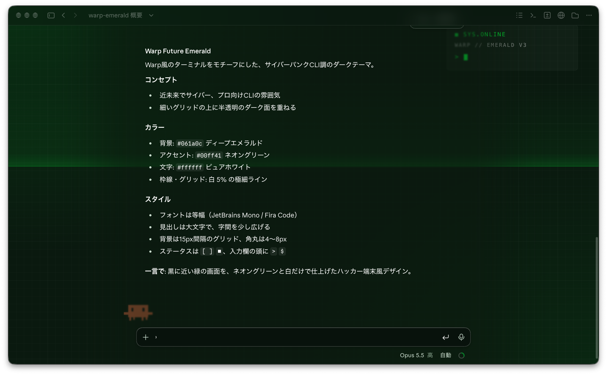

# claude-mods

Claude Code plugin marketplace maintained by [mextexco](https://github.com/mextexco).

## Add this marketplace

In Claude Code, run:

```text
/plugin marketplace add mextexco/claude-mods
```

Then list available plugins with:

```text
/plugin
```

## Plugins

### warp-emerald

A theme for the Claude desktop app, based on the Warp Future Emerald V3 design system: deep emerald surfaces (`#061a0c`), neon terminal green (`#00ff41`) and white text. Behind the chat it draws an 18px grid with a slow green scanline, a small status HUD in the top-right corner, and a pixel crab (from [mextexco/kani](https://github.com/mextexco/kani)) walking back and forth above the prompt box. Dark mode only. Terminals and editors don't draw themes.



#### Install

Pick **one** of these. All three do the same thing.

**A. Desktop app** (`/plugin` doesn't run there)

1. Click **+** next to the prompt box → **Plugins**.
2. **Add marketplace** → enter `mextexco/claude-mods`.
3. **Add plugin** → choose `warp-emerald`, scope **user**.

**B. Terminal session of Claude Code**

```text
/plugin install warp-emerald --marketplace mextexco/claude-mods
```

Answer `y` to add the marketplace, then pick scope **user**.

**C. Shell**

```bash
claude plugin install warp-emerald --marketplace mextexco/claude-mods
```

#### After installing

1. **Open a new session in the desktop app.** Sessions that were already open don't pick it up; in those, type `/warp-emerald`.
2. Set the app to dark mode (Settings → General → Appearance). The theme is made for dark windows only.

#### Not showing?

| Symptom | Fix |
|---|---|
| Still the plain look in an old session | Type `/warp-emerald`, or open a new session |
| A different backdrop (lagoon, starfield…) shows instead | theme-examples is applying its own theme. Run `/custom-theme off`, then `/warp-emerald` (see below) |
| `/warp-emerald` is an unknown command | You have 0.1.x. Update (see below) |
| Nothing in a terminal or IDE | Expected. Only the desktop app draws themes |

#### Commands

| Command | What it does |
|---|---|
| `/warp-emerald` | Apply the theme to this session (also brings it back after another theme cleared it) |
| `/warp-emerald off` | Clear it for this session |

The theme is applied automatically at the start of every session, so you rarely need these.

#### Update

```bash
claude plugin marketplace update claude-mods
```

```bash
claude plugin update warp-emerald@claude-mods
```

Then restart the desktop app.

#### warp-emerald and theme-examples

They are two separate plugins. You don't need theme-examples to use warp-emerald.

| | warp-emerald | theme-examples |
|---|---|---|
| From | this repo (`claude-mods`) | Anthropic's official marketplace (`claude-plugins-official`) |
| What | one theme: Warp Future Emerald | 20 animated sample backdrops, meant to be read and copied |
| Command | `/warp-emerald` | `/custom-theme`, `/fireworks` |
| Remembers | nothing; applies itself to every new session | your choice per project or per session |

warp-emerald uses the same theme API that theme-examples demonstrates. Both draw into the same single slot: **a session shows one theme at a time**, and whichever sets it last wins. That's why they can get in each other's way:

- If you picked a theme with `/custom-theme`, theme-examples remembers it for that project and puts it back when a session starts, covering warp-emerald. Run `/custom-theme off` in that project to stop this.
- `off` in either plugin clears whatever theme is showing, including the other plugin's. Use `/warp-emerald` to bring Emerald back.
- If you only want Emerald, disabling theme-examples is the simplest fix:

```bash
claude plugin disable theme-examples@claude-plugins-official
```

## Publish a plugin

Add a plugin directory to this repository (for example, `plugins/my-plugin/`) with its own `.claude-plugin/plugin.json` manifest, then add an entry to `.claude-plugin/marketplace.json`:

```json
{
  "name": "my-plugin",
  "source": "./plugins/my-plugin"
}
```
